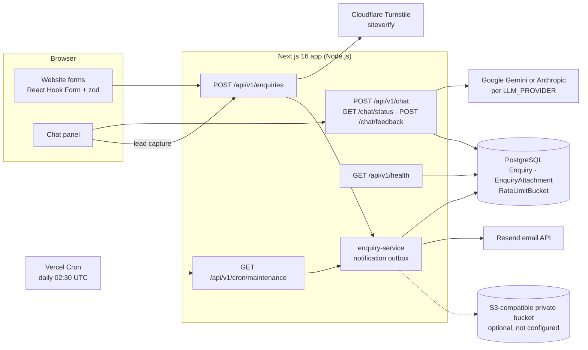
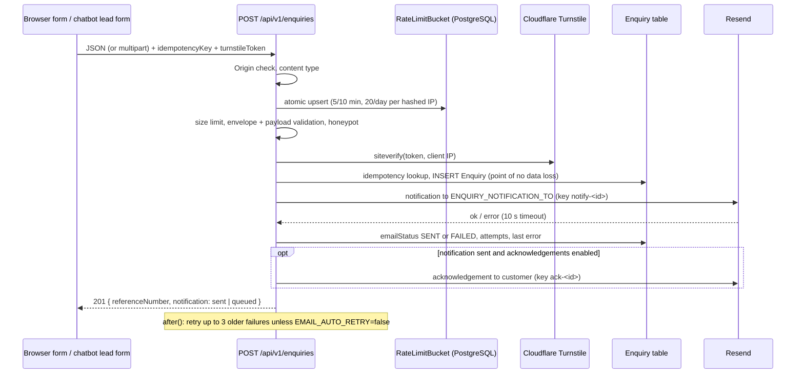

# Backend developer handover: Safe Bharat Fire and Safety Solutions website

| | |
| --- | --- |
| Document version | 1.0 |
| Prepared | 2026-10-21 |
| Audience | An experienced backend developer new to this project |
| Repository | The project folder `safebharatwebsite` (Next.js 16, TypeScript). See section A.5 on version control. |
| Detailed references | [`API_REFERENCE.md`](API_REFERENCE.md) · [`ENVIRONMENT_CONFIGURATION.md`](ENVIRONMENT_CONFIGURATION.md) |
| Related documents | [`DEPLOYMENT.md`](DEPLOYMENT.md) · [`OPERATIONS.md`](OPERATIONS.md) · [`LAUNCH_READINESS.md`](LAUNCH_READINESS.md) · [`HUMAN_APPROVAL_PACKAGE.md`](HUMAN_APPROVAL_PACKAGE.md) · [`../README.md`](../README.md) |

**How this document was prepared:**
- Everything here comes from reading the source code, configuration and migrations on 2026-10-21, plus read-only checks of the local environment. Where a statement relies on an earlier recorded event rather than a check made today, it says so.
- The labels **Verified**, **Not verified** and **Open question** are used throughout.
- No application code, environment file, database content or deployment state was changed while preparing it.

**Current backend status in one paragraph:**
- The backend is implemented and its automated tests pass locally. It covers enquiry capture, a notification outbox with retries, spam protection, rate limiting, an AI chatbot with an offline fallback, optional attachments, health checks and a scheduled maintenance job.
- It has **not been deployed**, and **no production configuration exists yet**.
- **Email delivery to the sales inbox has not been demonstrated:** the local sender is Resend's testing address (`onboarding@resend.dev`), and all three enquiries in the development database failed to notify for that reason.
- Launch depends on a confirmed domain, a verified sending domain, production Turnstile keys, a production database, and the owner, engineer and legal approvals tracked in `HUMAN_APPROVAL_PACKAGE.md`.

---

## A. Project overview

### A.1 Purpose

A corporate website for Safe Bharat Fire and Safety Solutions, a fire protection company in Visakhapatnam, Andhra Pradesh. It presents services, industries and an equipment catalogue, and captures sales leads:
- contact, quote, AMC (annual maintenance contract), equipment and callback enquiries;
- leads captured through an AI assistant.

### A.2 Architecture

There is one Next.js application: pages and API route handlers in the same deployable. There is no separate backend service. Server logic runs in Next.js route handlers on the Node.js runtime. PostgreSQL is the only datastore.



### A.3 Technologies (installed versions, verified 2026-10-21)

| Area | Technology | Version |
| --- | --- | --- |
| Runtime | Node.js (local machine) | 22.14.0 |
| Framework | Next.js App Router; `cacheComponents` and `partialPrefetching` enabled | 16.4.1 |
| UI | React | 19.3.0 |
| Language | TypeScript | 5.9.3 |
| Validation | zod (shared by browser forms and API) | 4.6.7 |
| ORM | Prisma Client with `@prisma/adapter-pg` over `pg` | 7.10.0 / 7.10.0 / 8.23.1 |
| Database | PostgreSQL. Local service is 17.11; `docker-compose.yml` offers 15. | 17.11 (local) |
| Email | `resend` SDK | 6.33.0 |
| AI | `@google/genai` (Gemini), `@anthropic-ai/sdk` (Anthropic) | 2.30.0 / 0.134.0 |
| Storage | `@aws-sdk/client-s3` (optional attachments) | 3.1152.0 |
| Tests | Vitest, Playwright (+ axe-core) | 5.0.4 / 1.64.1 |

### A.4 Enquiry request and data flow



### A.5 External integrations

| Integration | Purpose | Status (2026-10-21) |
| --- | --- | --- |
| Resend | Business notification and customer acknowledgement emails | A local key is set, but the sender is `onboarding@resend.dev` (testing sender). **Delivery to the sales inbox not verified.** |
| Cloudflare Turnstile | Bot protection on enquiry forms | Cloudflare **test** keys locally. Production keys not created. |
| Google Gemini (selected) / Anthropic (alternative) | AI assistant | `LLM_PROVIDER=gemini` and a key is set locally. Live behaviour was not tested in this review; automated tests use a stub. |
| S3-compatible storage | Optional enquiry attachments | Not configured; the feature is hidden |
| Vercel Cron | Daily maintenance job (`vercel.json`) | Becomes active only when deployed on Vercel |

**Version control:** the folder sits inside a Git repository that has **no commits**, so there is no history to review. Before handover, the owner should create a proper repository. It must **not** include `.env`, `.env.local` or the `.env.local.bak-*` files in the project root, which hold local secrets. `.gitignore` already excludes `.env*` except `.env.example`.

---

## B. Existing backend architecture

### B.1 Route handlers and server logic

- **Route files:** route handlers live in `src/app/api/v1/**/route.ts`. Each is a thin adapter. The logic sits in framework-independent modules that take injected dependencies, so they can be tested with real `Request` objects:
  - enquiries: `src/lib/enquiries/handle-enquiry-request.ts`
  - chat: `src/lib/ai/handle-chat-request.ts`
- **Production wiring:** `src/lib/runtime.ts` builds the production dependencies: the database client, the Resend sender (or `UnconfiguredEmailSender`), and the S3 storage (or none).
- **Server-only modules:** `src/lib/env.ts`, `src/lib/db.ts`, `src/lib/runtime.ts` and `src/lib/ai/provider.ts` import `server-only`.

### B.2 Validation and error handling

- **One schema everywhere:** the same zod schemas validate in the browser (React Hook Form) and on the server (`src/lib/validation/enquiry.ts`, `src/lib/ai/types.ts`).
- **Text cleaning:** input is NFC-normalised, control and bidirectional-override characters are removed, and fields are trimmed and length-capped.
- **Body limits:** read with a hard byte cap even when `Content-Length` is missing or wrong (`readBodyWithLimit`):
  - enquiries: 32 KB as JSON, 4 MB + 256 KB as multipart;
  - chat: 24 KB;
  - feedback: 512 bytes.
- **Error responses:** all use `src/lib/api/response.ts`, with stable error codes and no internal details. Errors are logged by event name and error class only.

### B.3 Database access and persistence

- **Client:** one `PrismaClient` per server process, cached on `globalThis` (`getDb()`). Without `DATABASE_URL`, it throws `DatabaseNotConfiguredError`, which the enquiry route maps to 503.
- **Write path:**
  - The enquiry is inserted **before** any email is attempted.
  - Duplicates are prevented by the unique `idempotencyKey`. Concurrent duplicates are handled by catching the unique-violation error (P2002) and returning the original reference.
  - A reference-number collision is retried up to 5 times.

### B.4 Email notification delivery

- **Sender:** `ResendEmailSender` (`src/lib/email/email-service.ts`) sends from `EMAIL_FROM`. The customer's address is used only as Reply-To, and only when it passes a strict address check.
- **Reliability:** every send has a 10-second timeout and a Resend idempotency key.
- **Templates:** in `src/lib/email/templates.ts`. All interpolated values are HTML-escaped.
- **Order:** the acknowledgement is sent only after the business notification has succeeded.

### B.5 Retries and failed notifications

- **Outbox fields:** the `Enquiry` row is the outbox. It records `emailStatus`, `emailAttempts`, `emailLastError`, `emailLastAttemptAt` and `emailSentAt`.
- **Triggers:** `retryPendingNotifications()` runs:
  - in the background after each successful submission (batch of 3), via Next.js `after()`;
  - in the maintenance job (batch of 20).
- **Selection and safety:**
  - Eligible rows have status `PENDING`, `FAILED` or `NOT_CONFIGURED`, fewer than 6 attempts, and a last attempt more than 5 minutes ago.
  - Each row is claimed with a conditional `updateMany`, so concurrent workers can't send twice.
- **Pause switch:** `EMAIL_AUTO_RETRY=false` pauses both triggers and leaves rows untouched. It is currently `false` locally.
- **Limits (verified in code):**
  - Customer acknowledgement failures are logged but **never retried**.
  - A notification that reaches 6 failed attempts stays `FAILED` permanently. Only a log warning is written; there is no alert.

### B.6 Chatbot and offline behaviour

- **Provider choice:** `LLM_PROVIDER` selects `GeminiChatProvider` or `AnthropicChatProvider` (`src/lib/ai/`). There is **no automatic fallback** between them.
- **Offline state:**
  - With no key, or an unknown provider, the chat returns 503 `CHAT_UNAVAILABLE`.
  - `GET /api/v1/chat/status` reports `available: false`, and the panel shows phone and email options instead.
- **Busy state:** provider rate limits, outages and timeouts (30 seconds) return 503 `CHAT_BUSY`.
- **Emergencies:** messages describing a fire, gas leak, explosion or trapped person are detected with fixed patterns and answered with fixed guidance (call 112). They never reach the model and are not rate-limited.
- **Answers:**
  - grounded in a keyword-retrieved knowledge base built from `src/content/*`;
  - model output must match a JSON schema;
  - replies are cleaned, checked for prompt or API-key leakage, and may link only to retrieved pages.
- **Privacy:** conversations are not stored.
- **Leads:** lead capture inside the chat posts to `/api/v1/enquiries` with `source: "CHATBOT"`.

### B.7 Spam prevention and rate limiting

| Layer | Where | Behaviour |
| --- | --- | --- |
| Origin check | all public POST routes | A cross-site `Origin` gets 401; requests without an `Origin` header pass |
| Honeypot field `website` | enquiries | Any value gets 400, and nothing is saved |
| Cloudflare Turnstile | enquiries | Server-side siteverify (5-second timeout). In production, a missing or test secret fails closed with 503. In development, a missing secret skips the check. |
| Rate limits | enquiries, chat, feedback | PostgreSQL fixed windows (atomic upsert) shared across instances. Hashed IP keys; raw IPs are never stored. |

### B.8 Health checks and maintenance

- **`GET /api/v1/health`:** checks the database with `SELECT 1` (503 if it fails) and reports the configuration state of each integration.
- **`GET /api/v1/cron/maintenance`:** protected by a Bearer `CRON_SECRET`. It runs notification retries, the retention purge and rate-limit bucket cleanup.

### B.9 Attachments

Implemented and disabled:
- **Files:** one PDF, PNG or JPEG of up to 4 MB, identified by its leading bytes.
- **Storage:** a private bucket under a random key (`enquiries/YYYY/MM/<uuid>.<ext>`), with `Content-Disposition: attachment`. A SHA-256 hash and metadata are stored in `EnquiryAttachment`. No public URL is ever generated.
- **Clean-up:** the object is deleted if the database insert fails.

### B.10 Responsibilities: this codebase vs external providers

| Responsibility | Handled by |
| --- | --- |
| Validation, persistence, idempotency, outbox and retries, rate limiting, emergency detection, chat output checks, retention | This codebase (Next.js server) |
| Email transport, sender authentication (SPF/DKIM), deliverability | Resend, plus DNS on the company domain |
| Bot detection | Cloudflare Turnstile |
| Language model inference | Google Gemini or Anthropic |
| Object storage (if enabled) | S3 or Cloudflare R2 |
| Scheduling, TLS, logs, environment secrets | The hosting platform (Vercel assumed by `vercel.json` and `DEPLOYMENT.md`; not yet chosen) |
| Backups and point-in-time recovery | The managed PostgreSQL provider (not yet chosen) |

---

## C. API endpoint reference (summary)

Full request and response details, validation rules and effects are in **[`API_REFERENCE.md`](API_REFERENCE.md)**.

| Method | Route | Purpose | Auth | Main status codes | Effects | Source |
| --- | --- | --- | --- | --- | --- | --- |
| POST | `/api/v1/enquiries` | Submit an enquiry (5 types; JSON or multipart) | Public. Origin check, rate limit, honeypot, Turnstile. | 201 new, 200 duplicate, 400, 401, 413, 415, 422, 429, 503, 500 | Inserts `Enquiry` (and `EnquiryAttachment`); Resend emails; optional S3 put; rate-limit upsert | `src/app/api/v1/enquiries/route.ts` |
| POST | `/api/v1/chat` | Assistant reply | Public. Origin check, rate limit. | 200, 401, 413, 415, 422, 429, 503 (`CHAT_UNAVAILABLE` / `CHAT_BUSY`), 500 | Gemini or Anthropic call; rate-limit upsert; nothing stored | `src/app/api/v1/chat/route.ts` |
| GET | `/api/v1/chat/status` | Is the assistant configured? | Public | 200 | None | `src/app/api/v1/chat/status/route.ts` |
| POST | `/api/v1/chat/feedback` | Anonymous rating | Public. Origin check, rate limit. | 200, 401, 422, 429, 503 | Log line and rate-limit upsert | `src/app/api/v1/chat/feedback/route.ts` |
| GET | `/api/v1/health` | Readiness and configuration status | Public | 200 / 503 | `SELECT 1` | `src/app/api/v1/health/route.ts` |
| GET | `/api/v1/cron/maintenance` | Retries, retention, cleanup | `Authorization: Bearer <CRON_SECRET>` | 200, 401, 500 | Resend sends; `Enquiry` updates and deletes; S3 deletes; bucket purge | `src/app/api/v1/cron/maintenance/route.ts` |

There are **no** staff, admin, authentication or enquiry-read endpoints.

---

## D. Database documentation

### D.1 Engine, ORM and client

- **Engine and ORM:** PostgreSQL with Prisma 7.10. The schema is `prisma/schema.prisma`, and the CLI configuration is `prisma.config.ts`, which loads `.env.local` then `.env`.
- **Generated client:** written to `src/generated/prisma`. This folder is git-ignored and regenerated by `npm install` (`postinstall: prisma generate`).
- **Driver:** connections go through the `pg` driver adapter (`PrismaPg`).

### D.2 Tables

| Table | Purpose |
| --- | --- |
| `Enquiry` | Every enquiry and chatbot lead, plus its notification outbox state |
| `EnquiryAttachment` | Metadata for uploaded files. `enquiryId` → `Enquiry.id`, `ON DELETE CASCADE`. |
| `RateLimitBucket` | Fixed-window counters keyed by `<rule>:<hashed IP>` |
| `_prisma_migrations` | Prisma's migration ledger |

**`Enquiry` columns** (UUID primary key `id`):

| Group | Columns |
| --- | --- |
| Identity | `referenceNumber` (VARCHAR 20, unique), `idempotencyKey` (VARCHAR 64, unique) |
| Classification | `enquiryType` (enum `CONTACT`, `QUOTE`, `AMC`, `EQUIPMENT`, `CALLBACK`), `source` (enum `WEBSITE_FORM`, `CHATBOT`; default `WEBSITE_FORM`), `status` (enum `NEW`, `IN_PROGRESS`, `CLOSED`, `SPAM`; default `NEW`) |
| Contact | `fullName` (120), `email` (254), `phone` (20), `companyName` (160, nullable), `jobRole` (120, nullable), `siteLocation` (200, nullable) |
| Request | `serviceRequired` (120), `message` (TEXT), `approximateScope` (500), `systemType` (120), `equipmentQuantity` (120), `currentMaintenance` (500), `preferredContactMethod` (enum `PHONE`, `EMAIL`, `WHATSAPP`), `productSlug` (120). All nullable except `message`. |
| Consent | `consentGiven` (boolean), `consentAt` (timestamp), `privacyNoticeVersion` (VARCHAR 20; currently `2026-10`) |
| Outbox | `emailStatus` (enum `PENDING`, `SENT`, `FAILED`, `NOT_CONFIGURED`; default `PENDING`), `emailAttempts` (int, default 0), `emailLastError` (500), `emailLastAttemptAt`, `emailSentAt`, `acknowledgementSentAt` |
| Audit | `createdAt` (default now), `updatedAt` (`@updatedAt`) |

**Indexes:**
- `Enquiry`: `createdAt`; (`enquiryType`, `createdAt`); (`status`, `createdAt`); (`emailStatus`, `emailAttempts`); `email`.
- `EnquiryAttachment`: unique `storageKey`; `enquiryId`.
- `RateLimitBucket`: `expiresAt`.

### D.3 Migration history

| Migration | Content | Applied |
| --- | --- | --- |
| `20261015040326_init` | All enums, tables, indexes and the foreign key above | Development database: **verified** (read-only check, 2026-10-21). Test database: applied before the last integration run (2026-10-16); not rechecked today. |

### D.4 Status handling

- **`status` is not used by any code path** (verified). Every row stays `NEW`, because there is no staff interface to change it. Updating it today means using the database console; see `OPERATIONS.md`.
- **`emailStatus` lifecycle:**

```mermaid
stateDiagram-v2
  [*] --> PENDING: saved, email configured
  [*] --> NOT_CONFIGURED: saved, email not configured
  PENDING --> SENT: notification accepted by Resend
  PENDING --> FAILED: provider error or 10 s timeout
  NOT_CONFIGURED --> SENT: retry after email is configured
  FAILED --> SENT: retry succeeds
  FAILED --> FAILED: retry fails (attempts + 1; stops at 6)
```



- **Current development data** (read-only, counts only): 3 enquiries, all `FAILED` after at most 2 attempts. Each `emailLastError` is a Resend `validation_error` about the testing-sender restriction (section E). There are no attachments.

### D.5 Test database and safe practice

- **Isolation:** integration tests require `TEST_DATABASE_URL` to point at a database whose name ends in `_test`. This is enforced in `tests/support/setup-integration.ts` and `scripts/migrate-test-db.mjs`.
- **Test data is wiped:** the tests **delete all rows** in that database's tables. Never relax the `_test` check, and never point it at a shared or production database.
- **Applying migrations to the test database:** `npm run test:db:migrate`, which runs `prisma migrate deploy`.
- **Local database setup:** `scripts/setup-local-db.ps1` creates a least-privilege role plus the `safebharat` and `safebharat_test` databases on a native Windows PostgreSQL. It only creates objects, and stops if they already exist. Docker users can run `docker compose up -d` instead.

---

## E. Email integration

| Item | Verified state |
| --- | --- |
| Sender variable | `EMAIL_FROM` (alias `CONTACT_FROM_EMAIL`). Locally `onboarding@resend.dev`, Resend's **testing** sender. |
| Recipient variable | `ENQUIRY_NOTIFICATION_TO` (alias `CONTACT_NOTIFICATION_EMAIL`). Locally `safebharatsales@gmail.com`, the intended sales inbox. |
| Acknowledgement | `SEND_CUSTOMER_ACKNOWLEDGEMENT` (enabled unless `false`) |
| Automatic retry | `EMAIL_AUTO_RETRY`, currently **`false`** locally (paused) |
| Health | `email: "configured"` only means a key, a sender and a recipient are set and the sender isn't a free-mail domain. **It does not prove delivery.** |

**Why the testing sender cannot reach the sales inbox:** Resend's `onboarding@resend.dev` only delivers to the email address of the Resend account owner. Sending to any other recipient is rejected with a `validation_error`.
- This is exactly what happened to the 3 development enquiries addressed to `safebharatsales@gmail.com`.
- On 2026-10-16, one manual test email to the account owner's own address was **accepted** by Resend. That proves the API key works; it says nothing about delivery to the sales inbox.

**Required to make notifications work:**
1. Confirm the company domain (owner).
2. In Resend, add and verify that domain by publishing its SPF and DKIM DNS records.
3. Set `EMAIL_FROM` to an address on it, for example `Safe Bharat <enquiries@<domain>>`.
4. Create a production `RESEND_API_KEY`.
5. **Sales notifications must not be considered working** until a test enquiry has actually reached `safebharatsales@gmail.com` from the verified domain.

**Failure recording and safe retries:**
- Failures are stored on the enquiry. To list them: `SELECT "referenceNumber", "emailStatus", "emailAttempts", "emailLastError" FROM "Enquiry" WHERE "emailStatus" <> 'SENT';`
- Retries reuse the Resend idempotency key `notify-<enquiry id>`, so a notification that did go through is not duplicated.
- **Before setting `EMAIL_AUTO_RETRY` back on** (or removing it): decide with the owner whether pending failures should be sent once the sender is fixed. That applies to the 3 local ones too; they are development data, not production.

**Testing email without contacting real customers:**
- **Automated tests** use `FakeEmailSender` and never call Resend. E2E runs with `RESEND_API_KEY=""`.
- **One-off live check of the integration:** `npm run email:test` (`tests/live/resend-test-email.test.ts`).
  - It is skipped unless `LIVE_EMAIL_TEST_TO` is set, and sends **exactly one** synthetic `[TEST]` email only if `LIVE_EMAIL_TEST_SEND=yes`.
  - It uses the real templates, touches no database, and never changes `ENQUIRY_NOTIFICATION_TO`.
- **End-to-end check after domain verification:** on a staging deployment, submit one enquiry using **your own** address in the customer email field. The acknowledgement then goes to you, and the notification goes to the sales inbox, whose owner should be told to expect a test.

---

## F. Environment variable reference (summary)

The full table, with purpose, usage location, local status and production action, is in **[`ENVIRONMENT_CONFIGURATION.md`](ENVIRONMENT_CONFIGURATION.md)**. No values are recorded there.

| Group | Variables | Local status (2026-10-21) | Production |
| --- | --- | --- | --- |
| Site | `NEXT_PUBLIC_SITE_URL` | Local `http://localhost` address | **Pending**: confirmed `https://` domain |
| Database | `DATABASE_URL`, `TEST_DATABASE_URL` | Set (local PostgreSQL) | **Pending**: managed database. Test database never in production. |
| Email | `RESEND_API_KEY`, `EMAIL_FROM`, `ENQUIRY_NOTIFICATION_TO`, `SEND_CUSTOMER_ACKNOWLEDGEMENT`, `EMAIL_AUTO_RETRY` | Set. Testing sender; retries paused. | **Pending**: verified-domain sender and production key |
| Turnstile | `NEXT_PUBLIC_TURNSTILE_SITE_KEY`, `TURNSTILE_SECRET_KEY`, `ALLOW_TURNSTILE_TEST_KEYS` | Test keys; allow-test flag not set | **Pending**: real keys; the allow-test flag must stay unset |
| AI | `LLM_PROVIDER`, `GEMINI_API_KEY`, `GEMINI_MODEL`, `GEMINI_THINKING_LEVEL`, `LLM_API_KEY`, `LLM_MODEL`, `LLM_EFFORT` | Gemini selected, key set | **Pending**: billing-enabled key |
| Attachments | `ATTACHMENTS_*` | Not configured | Optional |
| Operations | `CRON_SECRET`, `RATE_LIMIT_SALT`, `ENQUIRY_RETENTION_DAYS`, `NEXT_PUBLIC_WHATSAPP_NUMBER` | Cron secret set; salt is the `.env.example` placeholder; retention 730 | **Pending**: random secret and salt |

---

## G. Security requirements

| Area | Implemented (verified in code) | Missing, unverified or to check |
| --- | --- | --- |
| Input validation | zod schemas on every route; text normalisation; length caps; hard body-size limits; allow-listed enum values and slugs | – |
| Rate limiting | Shared PostgreSQL buckets; hashed IPs; enquiries and chat **fail closed** if the store is down | **Self-hosting:** the client IP comes from `x-real-ip` / `x-forwarded-for`, so a reverse proxy must overwrite these headers. On Vercel the platform sets them. Verify on the chosen host. |
| Spam protection | Turnstile siteverify; production refuses missing or test secrets; honeypot | Production keys not created. The **chat endpoint has no Turnstile**: it relies on rate limits and the provider's own spending limits. Set a spend cap with the AI provider. |
| Authentication and authorisation | Only the maintenance route is protected (constant-time Bearer secret) | **There is no authentication system and no staff dashboard.** Enquiries can only be read through database access. Any future dashboard needs real authentication and role checks. |
| Customer data access | No endpoint returns stored enquiries; responses carry only the reference number | Restrict production database credentials to the people who need them. Prefer read-only roles for inspection (`OPERATIONS.md` recommends `prisma studio` against a read-only connection). |
| Secret management | Server-only secrets read through `serverEnv` (`server-only` guard); no AI or email key in a `NEXT_PUBLIC_*` variable; chat replies are checked for key leakage | `RATE_LIMIT_SALT` **silently falls back to a built-in default** when unset, and the local value is the placeholder. Set a real one in production. Keep secrets only in the host's encrypted settings. |
| Error responses and logging | Generic error messages; structured JSON logs that redact keys matching key, token, secret, password, email, phone, message, content or name; no request bodies logged | No error tracking or alerting is configured (there is no `instrumentation.ts`). |
| Database and migrations | Parameterised Prisma queries (the three raw SQL statements, for the rate-limit upsert, bucket purge and health check, use tagged templates); migrations are SQL files in `prisma/migrations` | Use `prisma migrate deploy` in production, never `migrate dev`. Enable backups first. |
| Attachments | Signature-checked types; 4 MB limit; sanitised names; private bucket; random keys; no public URLs | Disabled. If enabled: keep the bucket private, use a minimal-scope access key, and consider malware scanning (not implemented). |
| Cron endpoint | Bearer `CRON_SECRET`, constant-time comparison; unset secret means always 401; returns counts only | Set `CRON_SECRET` in production. Vercel sends it automatically. |
| CORS and security headers | No CORS headers (same-origin only). `next.config.ts` sets CSP (`frame-ancestors 'none'`), `X-Frame-Options: DENY`, `nosniff`, `Referrer-Policy`, `Permissions-Policy`, `COOP`, and HSTS in production. `poweredByHeader: false`. | The CSP allows `'unsafe-inline'` scripts. A nonce-based CSP would be stronger (optional hardening). |
| Information disclosure | Health reports configuration state only, never values | `/api/v1/health` is public and reveals which integrations are configured and which AI provider is used. Restrict it to monitoring if preferred (optional). |
| Privacy | Chat conversations not stored; retention purge (`ENQUIRY_RETENTION_DAYS`); consent version recorded on every enquiry | The privacy policy and terms still need legal review (`HUMAN_APPROVAL_PACKAGE.md`, L1). |

---

## H. Local setup and development

Prerequisites: Node.js 22 or later, npm, and PostgreSQL, either a native service or `docker compose`. All commands come from `package.json` and the scripts folder.

```bash
npm install                      # installs dependencies and runs `prisma generate`
cp .env.example .env.local       # then fill in values; never commit this file
```

**Database:** choose one option.
- **Docker:** `docker compose up -d` starts PostgreSQL 15 on `localhost:5444` and creates a test database through `scripts/db/init-test-db.sql`.
- **Native Windows PostgreSQL:** run `powershell -ExecutionPolicy Bypass -File scripts\setup-local-db.ps1`. It creates the role and databases, writes the URLs to `.env.local`, and never prints secrets.

```bash
npx prisma migrate deploy        # apply existing migrations to DATABASE_URL (non-destructive)
npm run test:db:migrate          # apply migrations to TEST_DATABASE_URL (name must end in _test)
npm run dev                      # http://localhost:3000; check /api/v1/health
npm run lint
npm run typecheck                # next typegen + tsc --noEmit
npm test                         # unit and component tests (no database, no network)
npm run test:integration         # real PostgreSQL test database
npm run build                    # production build; then `npm start`
npm run test:e2e                 # Playwright against the production build on port 3100 (run `npm run build` first)
```

- **Use `npx prisma migrate deploy` to apply existing migrations.** Use `npm run db:migrate` (`prisma migrate dev`) only when authoring a new migration: it can offer to **reset** a database that has drifted. Never run it against shared or production databases.
- **Without email credentials,** enquiries are saved as `NOT_CONFIGURED`.
- **Without Turnstile keys,** verification is skipped in development only.
- **Without an AI key,** the chat shows its offline state.

---

## I. Testing and validation

| Suite | Location | What it covers | External services |
| --- | --- | --- | --- |
| Unit and component (Vitest, jsdom) | `tests/unit/*.test.{ts,tsx}`, 9 files | Validation, the enquiry handler (in-memory rate limiter), security helpers (body limits, origin, Turnstile including test-key refusal), chat service, Gemini provider mapping, environment parsing, SEO, assets, components | None. `StubChatProvider`, `FakeEmailSender`, `FakeStorage` and `MemoryRateLimitStore` from `tests/support/fakes.ts` and `src/lib/security/rate-limit.ts` |
| Integration (Vitest, Node) | `tests/integration/enquiries.test.ts`, `retry-pause.test.ts` | Persistence, notification failure and recovery, backoff and attempt limits, the not-configured to configured path, idempotency including concurrency, chatbot source, attachment rollback, retention, the HTTP route against PostgreSQL, the shared-store rate limiter, and the `EMAIL_AUTO_RETRY` pause on both retry paths | **Real PostgreSQL test database.** Fake email sender and fake storage. |
| End-to-end (Playwright + axe) | `e2e/site.spec.ts`, `e2e/mobile.spec.ts` | Routes and 404s, security headers, navigation, a client-side form check, **a quote request saved with a reference number**, the chatbot offline state and lead capture, assets, accessibility, and the footer and floating controls | Production build on port 3100 with `DATABASE_URL` set to the test database. `RESEND_API_KEY`, `LLM_API_KEY` and `GEMINI_API_KEY` blanked; Cloudflare test keys (needs network); `ALLOW_TURNSTILE_TEST_KEYS=true` (`playwright.config.ts`) |
| Live (opt-in) | `tests/live/resend-test-email.test.ts` | One real Resend send | Resend. Runs only with `LIVE_EMAIL_TEST_TO` and `LIVE_EMAIL_TEST_SEND=yes`. |

**Results.** Checks rerun on 2026-10-21 for this document did not touch any database:

| Check | Result | When |
| --- | --- | --- |
| `npm run lint` | Pass (exit 0) | **Rerun 2026-10-21** |
| `npm run typecheck` | Pass (exit 0) | **Rerun 2026-10-21** |
| `npm test` | 173 passed, 9 files | **Rerun 2026-10-21** |
| `npm run build` | Pass, 69 static pages | **Rerun 2026-10-21** |
| `npm run test:integration` | 19 passed, 2 files | **Not rerun** (writes to the test database). Last run 2026-10-16. |
| `npm run test:e2e` | 62 passed | **Not rerun** (writes to the test database). Last run 2026-10-16. |
| `npm run email:test` | One test email accepted by Resend, to the account owner's address | 2026-10-16. Not rerun. Delivery to the sales inbox never tested. |

**How to verify specific behaviour:**
- **Persistence:** run the integration suite. Or submit the quote form locally and check the row with `npx prisma studio`, or `SELECT "referenceNumber","emailStatus" FROM "Enquiry" ORDER BY "createdAt" DESC LIMIT 5;`
- **Notification delivery:** see section E (staging test after domain verification).
- **Chatbot fallback:**
  - unset the provider key, or leave it blank as the E2E config does;
  - `GET /api/v1/chat/status` should return `available: false`;
  - the panel should show contact options;
  - an emergency phrase ("there is a fire") should return fixed guidance even while offline.
- **Spam protection:**
  - the unit tests cover token refusal and test-key refusal in production;
  - manually, a `website` honeypot value returns 400;
  - in production with a missing or test secret, enquiries return 503.

**Known testing gaps:**
- There is no test for acknowledgement retries, because they are not implemented.
- There are no load or soak tests.
- Nothing tests against real Turnstile secrets or a real verified Resend domain.
- There is no automated live Gemini check (deliberate, to avoid paid calls).
- There are no production smoke tests beyond the manual checklist in `LAUNCH_READINESS.md`, section 8.

---

## J. Deployment and production readiness

The deployment procedure is in [`DEPLOYMENT.md`](DEPLOYMENT.md), and the launch blockers in [`LAUNCH_READINESS.md`](LAUNCH_READINESS.md). Summary of what remains, by responsible role:

| Requirement | Responsible | Notes |
| --- | --- | --- |
| Domain confirmed; `NEXT_PUBLIC_SITE_URL` set to its `https://` form | Owner (domain), developer (configuration) | Rebuild after setting it. Placeholder and test hosts stay `noindex`. |
| Resend domain verified (SPF/DKIM); production `EMAIL_FROM` and `RESEND_API_KEY` | Owner (DNS access), developer | See section E |
| Production Turnstile site key and secret for the hostname | Developer (Cloudflare account owner) | Test keys fail closed in production |
| Managed PostgreSQL with automated backups and point-in-time recovery | Developer / owner (billing) | Apply migrations with `npm run db:deploy` before the first deploy |
| `CRON_SECRET`, `RATE_LIMIT_SALT`, production AI key (billing-enabled), optional attachments | Developer | `ENVIRONMENT_CONFIGURATION.md` |
| Hosting project (Vercel assumed by `vercel.json`) with Production and Preview environments and separate secrets | Developer | Vercel Cron runs daily at 02:30 UTC; Pro plans can run it more often |
| Health check after deploy: `database: "ok"`, `email: "configured"`, `spamProtection: "configured"` | Developer | `/api/v1/health` |
| **Email delivery verified** to `safebharatsales@gmail.com` | Developer and owner | Required before launch |
| Monitoring: uptime on `/api/v1/health`; log alerts on the events listed in `OPERATIONS.md` | Developer | No error tracking or alerting configured yet |
| Backups restore-tested | Developer | `OPERATIONS.md` |
| Security checks (section G and the checklist in section L) | Developer | |
| Content, technical, owner and legal approvals | Owner, engineer, legal | `HUMAN_APPROVAL_PACKAGE.md` (38 checklist items, all pending) |

Do not deploy or change DNS without the owner's approval.

---

## K. Known issues and outstanding work

Only unresolved items are listed. Classification: **IV** implemented and verified · **IN** implemented but not verified in production · **CP** configuration pending · **DI** requires developer investigation · **AP** requires owner, engineer or legal approval.

| # | Item | Class | Detail and next step |
| --- | --- | --- | --- |
| 1 | Notification delivery to `safebharatsales@gmail.com` | **CP** | Local sender is `onboarding@resend.dev`. All 3 development enquiries failed with Resend's testing-sender `validation_error`. Needs a verified domain and a delivery test (section E). |
| 2 | Resend sending-domain verification and production sender | **CP** | Blocked on the domain decision (owner) and DNS access |
| 3 | `EMAIL_AUTO_RETRY=false` locally; 3 failed development notifications | **CP / AP** | Decide whether pending failures should be resent once the sender works, then remove the setting in production |
| 4 | Production Turnstile keys | **CP** | Create them for the production hostname |
| 5 | Production database, backups, migrations, hosting project, environment secrets | **CP** | See section J |
| 6 | `RATE_LIMIT_SALT` placeholder locally; silent default if unset | **CP / DI** | Set a random value. Consider failing closed in production when it is missing (code change; not made). |
| 7 | Customer acknowledgement failures are not retried | **DI** | Decide whether to add retry tracking (for example a separate acknowledgement status) |
| 8 | Notifications that reach 6 failures stay `FAILED` with no alert | **DI** | Add alerting or a periodic report (see item 9) |
| 9 | No error tracking or alerting | **DI** | `OPERATIONS.md` suggests Sentry or similar via `instrumentation.ts`; not configured |
| 10 | Client-IP trust on self-hosted servers | **IN** | Fine on Vercel. A self-hosted reverse proxy must overwrite `x-forwarded-for` / `x-real-ip`. |
| 11 | Chat endpoint protected only by rate limits | **IN / DI** | Set spend limits with the AI provider; consider Turnstile on chat if abuse appears |
| 12 | Gemini integration not exercised live in this review | **IN** | Key set locally. Test on staging with a billing-enabled key; the privacy policy must name the provider (legal L1). |
| 13 | `Enquiry.status` is never updated; there is no staff interface | **IV (by design) / AP** | Enquiries are reviewed in the email inbox and the database console. A dashboard would need an owner decision and proper authentication. |
| 14 | Public health endpoint reveals the integration configuration | **IV / DI** | Optional: restrict it to monitoring |
| 15 | CSP allows `'unsafe-inline'` scripts | **IV / DI** | Optional hardening with a nonce-based CSP |
| 16 | Attachments disabled | **AP** | If wanted: private bucket, minimal key, Vercel's 4.5 MB body limit already respected |
| 17 | Retention period (730 days) must match the privacy policy | **AP** | Legal and owner decision (`HUMAN_APPROVAL_PACKAGE.md`) |
| 18 | Repository has no commits; local secret files must not be shared | **AP / CP** | The owner creates the repository; exclude `.env`, `.env.local` and `.env.local.bak-*` |
| 19 | Documentation drift | **DI** | `README.md` says the chat goes offline "without `LLM_API_KEY`", but with `LLM_PROVIDER=gemini` the key is `GEMINI_API_KEY`. `OWNER_APPROVAL_CHECKLIST.md` lists an Anthropic key. Update both. |
| 20 | Content, standards and legal approvals | **AP** | 38 pending items in `HUMAN_APPROVAL_PACKAGE.md` |

Verified as working locally and not repeated as issues:
- enquiry persistence, idempotency, outbox retries and the pause switch;
- rate limiting, Turnstile enforcement logic, the chat offline state and emergency guidance;
- the health and maintenance endpoints;
- the security headers and the indexing guard.

---

## L. Backend developer acceptance checklist

**Repository and setup**
- [ ] Received the repository **without** `.env`, `.env.local` or `.env.local.bak-*` files
- [ ] `npm install` succeeds and `prisma generate` runs
- [ ] `.env.local` created from `.env.example`, with no secrets committed

**Database**
- [ ] Development and `_test` databases reachable; `npx prisma migrate deploy` and `npm run test:db:migrate` succeed
- [ ] `/api/v1/health` shows `database: "ok"` locally

**Enquiries**
- [ ] `npm run test:integration` passes (19 tests)
- [ ] Manual submission of each form type returns a reference number, and the row exists with the right `enquiryType` and `source`
- [ ] Duplicate submission (same idempotency key) returns `200` with the same reference

**Email**
- [ ] Domain verified in Resend; `EMAIL_FROM` on it; production key set
- [ ] One staging enquiry **delivered** to `safebharatsales@gmail.com` (confirmed by the inbox owner) and the acknowledgement received at your own address
- [ ] Failure path checked: with a deliberately invalid key on staging, the enquiry is still saved as `FAILED`, and the retry recovers it once the key is fixed
- [ ] Decision recorded on `EMAIL_AUTO_RETRY` and on the existing failed notifications

**Chatbot**
- [ ] With a billing-enabled key on staging, replies work and `chat/status` reports `available: true`
- [ ] With no key: offline state; emergency guidance still returned

**Spam protection and endpoint security**
- [ ] Production Turnstile keys set; `spamProtection: "configured"`; `ALLOW_TURNSTILE_TEST_KEYS` absent
- [ ] Honeypot and rate limits behave as documented (400 / 429)
- [ ] `/api/v1/cron/maintenance` returns 401 without the secret and 200 with it
- [ ] `RATE_LIMIT_SALT` and `CRON_SECRET` set to random values; client-IP headers trustworthy on the chosen host
- [ ] Security headers present on the live site (the E2E check `sends security headers`)

**Tests and build**
- [ ] `npm run lint`, `npm run typecheck`, `npm test`, `npm run build` and `npm run test:e2e` pass, with results recorded and dated

**Production readiness**
- [ ] Managed database with backups; restore tested
- [ ] Uptime monitoring on `/api/v1/health`; log alerts on `enquiry.save_failed`, `enquiry.notification_failed`, `turnstile.not_configured` and `cron.maintenance_failed`
- [ ] Live-site checks in `LAUNCH_READINESS.md`, section 8, completed

**Handover notes**
- [ ] Unresolved items from section K reviewed with the owner, and each one assigned or accepted as a risk
- [ ] This document updated with any changes, with a new version number and date

---

## Appendix: backend file map

| Path | Contents |
| --- | --- |
| `src/app/api/v1/` | Route handlers (see section C) |
| `src/lib/enquiries/` | `handle-enquiry-request.ts` (HTTP pipeline), `enquiry-service.ts` (persistence, outbox, retries, retention), `automatic-retry.ts` (`EMAIL_AUTO_RETRY` gating, maintenance), `reference.ts` |
| `src/lib/email/` | `email-service.ts` (Resend sender), `templates.ts` (HTML and text emails, escaped) |
| `src/lib/security/` | `rate-limit.ts`, `request.ts` (body limits, IP, origin), `spam-protection.ts` (Turnstile) |
| `src/lib/ai/` | Providers, chat service, knowledge index, system prompt, emergency detection, types |
| `src/lib/storage/attachments.ts` | Attachment validation and S3 storage |
| `src/lib/validation/enquiry.ts` | Shared zod schemas |
| `src/lib/env.ts`, `src/lib/runtime.ts`, `src/lib/db.ts`, `src/lib/logger.ts`, `src/lib/api/response.ts` | Configuration, dependency wiring, Prisma client, logging, response envelope |
| `prisma/` | `schema.prisma`, `migrations/` |
| `scripts/` | `migrate-test-db.mjs`, `run-maintenance.mjs`, `setup-local-db.ps1`, `configure-integrations.ps1` (writes keys to `.env.local` through hidden prompts), `reset-postgres-password.ps1` (resets the local `postgres` administrator password on a Windows PostgreSQL 17 service, editing `pg_hba.conf` temporarily; only for a locked-out local machine, never for shared servers) |
| `tests/`, `e2e/` | Test suites (section I) |
| `next.config.ts`, `vercel.json`, `docker-compose.yml`, `playwright.config.ts`, `vitest.config.mts` | Platform and tooling configuration |
